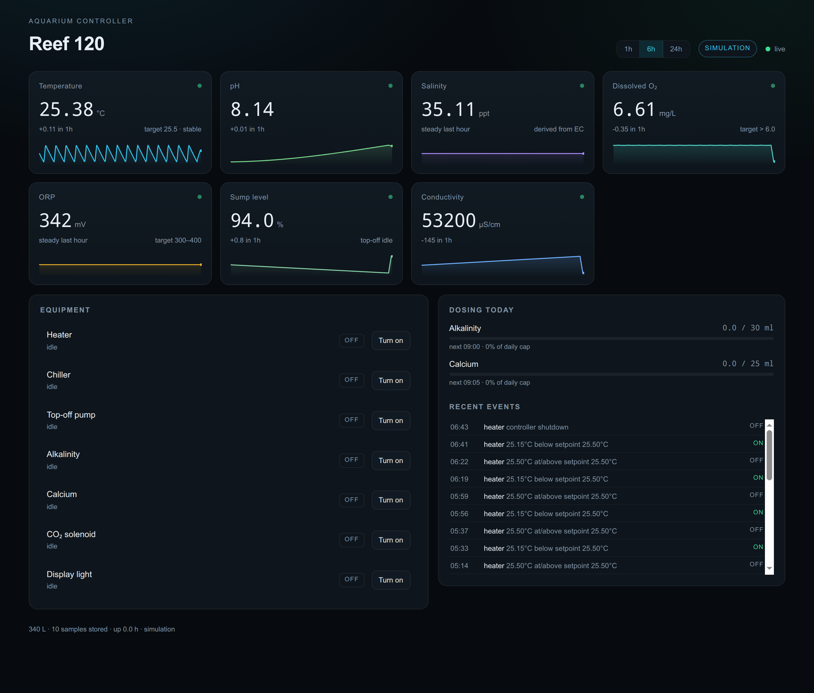

# Aquarium Controller

A small, self-hosted controller for a reef or freshwater tank: it reads probes,
holds the tank inside limits, logs everything, raises alerts, and serves a live
dashboard. Python 3.11+, standard library only at runtime, SQLite for history.

It starts in **simulation** — a physical model of a 340 L tank with a real
thermal mass, evaporation and a diurnal pH swing — so you can exercise every
loop before you buy a probe. Point the drivers at real hardware and the same
control code runs the tank.



## What it measures

| Metric | Typical target | Why it matters | Probe |
| --- | --- | --- | --- |
| Temperature | 24–26 °C reef, 22–26 °C fresh | Drives metabolism, oxygen and disease resistance | DS18B20 (1-Wire, ±0.5 °C, ~£4) |
| pH | 7.9–8.4 reef, 6.4–7.6 planted | Calcification vs. CO₂/acidification | Atlas EZO-pH, or ADS1115 + PH-4502C board |
| Salinity / conductivity | 34–36 ppt (≈50–54 mS/cm) | Osmotic stress; drifts whenever top-off fails | Atlas EZO-EC, or ADS1115 + TDS board |
| TDS | freshwater only | Rough dissolved-solids trend; on a reef the salinity number is the meaningful one | derived from EC |
| ORP | 300–400 mV reef | Organic load and redox balance | Atlas EZO-ORP |
| Dissolved oxygen | > 6 mg/L | Suffocation risk at night, overstocking, heat | Atlas EZO-DO |
| Sump level | 90–96 % of working range | Supervises the top-off pump; catches a siphon or a dry reservoir | float switch, pressure sensor, or ultrasonic |
| Turbidity | optional | Bacterial bloom, sandstorm, feeding response | ADS1115 + analog sensor |

Deliberately **not** closed-loop: alkalinity, calcium, magnesium, nitrate and
phosphate. There is no hobby-priced continuous sensor for them, so they are
dosed on a schedule with a hard daily cap, and you still test them by hand.
Ammonia and nitrite are test-kit-only at this price point. Flow monitoring is
not implemented — a return pump is a relay, not a measurement.

## Architecture

```
 probes ──► sensors/ ──► Runtime.poll() ──► control.py ──► relays (GPIO / HTTP)
 (sim, DS18B20, EZO,      │                    │  hysteresis, min on/off,
  ADS1115)                │                    │  max run, interlocks, dosing
                          ▼                    ▼
                     storage.py (SQLite)   alerts.py ──► webhook / shell command
                          │                    │
                          └──────► api.py (HTTP + SSE) ──► web dashboard
```

* **Sensors** never invent a value. A read that fails, goes stale, or lands
  outside a plausible range does not get smoothed over — it faults, and every
  loop that depends on it switches its outputs off.
* **Hardware** owns the relays and enforces minimum on/off times, maximum run
  times, manual overrides with a TTL, and a heater/chiller interlock.
* **Control** only decides what each loop wants. It is pure logic over
  readings, so it is fully unit-tested.
* **Alerts** debounce with a hold time, log every transition, and fan out to a
  webhook or any shell command (Telegram, ntfy, a siren script).

## Quick start (simulation)

```bash
git clone https://github.com/dustin5551212/aquarium-controller
cd aquarium-controller
uv venv .venv && uv pip install --python .venv/bin/python -e . pytest

.venv/bin/aqctl init          # writes ~/.config/aquarium/config.toml
.venv/bin/aqctl run           # dashboard on http://127.0.0.1:5176
```

Optional: give the charts some history to draw (simulation mode only).

```bash
.venv/bin/python scripts/seed_demo.py --hours 6
```

```bash
.venv/bin/aqctl status        # one-screen summary over the API
.venv/bin/aqctl dose dose_alk 12
.venv/bin/python -m pytest -q
```

## Going on real hardware

Minimum bill of materials for a Pi-based build:

* Raspberry Pi 4/5 (or any Linux box; GPIO is only needed for relays)
* Atlas Scientific **EZO-pH** and **EZO-EC** circuits in I²C mode (address 99
  by default, change it per probe), or a **PH-4502C** board + **ADS1115** ADC
  if you want the cheap route
* **DS18B20** temperature probe with a 4.7 kΩ pull-up to 3.3 V
* 8-channel **optocoupler relay board** (active-low boards are supported)
* Peristaltic dosing pumps (12 V, ~1–2 ml/s) for alkalinity and calcium
* A float switch or pressure transducer in the sump for top-off
* 12 V 5 A supply for pumps and relays, separate from the Pi's supply

```toml
[[sensors]]
metric = "ph"
driver = "ezo"
[sensors.params]
i2c_bus = 1
address = 99

[[sensors]]
metric = "temp_c"
driver = "ds18b20"          # or params.path = "/sys/bus/w1/devices/28-.../w1_slave"

[[sensors]]
metric = "level_pct"
driver = "ads1115"
[sensors.params]
i2c_bus = 1
channel = 2
mode = "linear"
scale = 25.0                # percent per volt, calibrate with a ruler
offset = 0.0

[[actuators]]
id = "heater"
kind = "heater"
driver = "gpio"
[sensors.params]
pin = 17
active_low = true
```

An HTTP relay (Shelly, Tasmota, ESPHome) needs no GPIO at all:

```toml
[[actuators]]
id = "ato_pump"
kind = "ato"
driver = "http"
[actuators.params]
url = "http://192.168.1.50/relay/0"
method = "POST"
```

### Safety notes — read before switching mains

* **Mains is not a hobby circuit.** Put heaters and pumps behind a GFCI/RCD,
  use a properly rated relay board with a snubber, and keep 230 V and probe
  wiring physically separated. If that is not something you want to do, buy a
  commercial controller and use this for sensing and alerts only.
* **Fail off.** Every relay defaults to off. If the process dies, the systemd
  unit stops it with SIGTERM and `Runtime.stop()` opens every relay.
* **Max run time is not optional.** `max_on_s` on a heater is what stops a
  stuck thermistor from cooking the tank; the top-off pump gets the same
  treatment plus a lockout, because a stuck ATO can flood a room.
* **pH and ORP probes must not share a ground** with pumps; use isolated
  circuits (the EZO modules are) and keep probe cables away from mains runs.
* Dosing pumps need a **daily cap** (`daily_max_ml`). The controller enforces
  it, but check the reservoir markings too — a siphon can dose a litre
  overnight.

## Configuration

`~/.config/aquarium/config.toml` — see [`config/default.toml`](config/default.toml)
for the annotated, working example.

### `[tank]`, `[server]`, `[safety]`

| Key | Meaning |
| --- | --- |
| `tank.name`, `tank.volume_l`, `tank.water_type` | Display, log context, and which units the dashboard shows (`reef` hides TDS, `fresh` hides salinity) |
| `server.host`, `server.port` | Bind address (default `0.0.0.0:5176`) |
| `server.sample_interval_s` | Persist readings this often (default 5 s) |
| `server.control_interval_s` | Control loop period (default 1 s) |
| `server.history_days` | Reading retention (default 30) |
| `server.token` | If set, every `/api/*` call needs `Authorization: Bearer <token>` or `?token=` |
| `safety.stale_after_s` | A reading older than this is a fault (default 45 s) |

### Sensors and actuators

`[[sensors]]` — `metric`, `driver` (`sim`, `ds18b20`, `ezo`, `ads1115`), `[sensors.params]`.

`[[actuators]]` — `id`, `kind` (`heater`, `chiller`, `ato`, `doser`, `co2`,
`light`, `pump`, `fan`), `driver` (`sim`, `http`, `gpio`), optional `label`,
`min_on_s`, `min_off_s`, `max_on_s`, `always_on`, and `[actuators.params]`
(`pin`/`chip`/`active_low` for GPIO, `url`/`on_url`/`off_url` for HTTP,
`rate_ml_s` for dosing pumps).

### Control loops

| Loop | Behaviour |
| --- | --- |
| `[control.temp]` | Heater on below `setpoint − deadband`, off at setpoint; chiller the mirror image. Never both. |
| `[control.ato]` | Pump on below `low_pct`, off at `high_pct`, `max_run_s` then a lockout, `cooldown_s` between runs. |
| `[control.light]` | Photoperiod with wrap-around (`22:00`–`06:00` works). |
| `[control.co2]` | Solenoid on above `target + hysteresis`, off at `target`, optional `lights_only`. |
| `[[control.dose]]` | Fixed `ml` at each `schedule` slot, capped by `daily_max_ml`; a missed window is skipped, not stacked. |

### Alerts and notifications

```toml
[[alerts]]
metric = "salinity_ppt"
below = 33.0
hold_s = 600
severity = "warning"
message = "Salinity low — check ATO / refractometer"

[notify]
webhook = "https://ntfy.sh/my-tank"     # POSTs JSON
command = "hermes send -t telegram:123456789 {message}"
cooldown_s = 300
```

Derived metrics (`salinity_ppt`, `tds_ppm`) are available to alerts, so you can
alert on salinity instead of raw conductivity. Optional per-probe factors:
`salinity_ppt_factor` (default 0.66, ppt per mS/cm) and `tds_ppm_factor`
(default 0.5).

## HTTP API

| Method | Path | Purpose |
| --- | --- | --- |
| GET | `/api/state` | Full snapshot: readings, relays, alerts, loop state |
| GET | `/api/history?minutes=360&points=300` | Downsampled series for the charts |
| GET | `/api/events?limit=50` | Relay transitions |
| GET | `/api/doses?limit=50` | Dose log |
| GET | `/api/alerts?limit=100` | Alert history |
| GET | `/api/health` | Liveness, mode, alert count |
| GET | `/api/stream` | Server-sent events, one snapshot per control cycle |
| POST | `/api/actuators/<id>` `{"on":true,"minutes":15}` | Manual override with a TTL |
| DELETE | `/api/actuators/<id>` | Return the relay to automatic |
| POST | `/api/actuators/<id>/dose` `{"ml":10}` | Run a dosing pump for a volume |
| POST | `/api/alerts/clear` `{"rule":"..."}` | Acknowledge (threshold alerts re-arm while still true) |

## Run it as a service

```bash
mkdir -p ~/.config/systemd/user
cp systemd/aquarium-controller.service ~/.config/systemd/user/
systemctl --user daemon-reload
systemctl --user enable --now aquarium-controller
loginctl enable-linger "$USER"      # keep it running while logged out
```

## Calibration

* **pH** — two-point (7.00 and 4.00 or 10.00 buffer) before you trust the
  number; `aqctl` does not automate the EZO calibration commands, run them over
  the same serial port once and the probe keeps them.
* **EC** — one-point at 53 mS/cm (or the sachet that came with the probe).
  Adjust `salinity_ppt_factor` if you have a refractometer to compare against.
* **ADS1115 analog boards** — set the `ph4502c` pots so pH 7 sits near 2.5 V,
  then correct `neutral_v` / `slope_ph_per_v` after a buffer test.
* **Level** — measure the distance at two known levels and solve `scale` and
  `offset`; write them into the sensor params.

## Limits

* Single-point pH and EC calibration; probe drift still happens, so the alert
  thresholds should be looser than your test-kit tolerance.
* Dosing is open-loop (schedule + cap). There is no alkalinity feedback.
* One sensor per metric. Adding a second pH probe would mean a small change to
  the sensor registry, not a config-only change.
* SQLite is fine for one tank; it is not a time-series database for a public
  multi-tenant service.

## Layout

```
aquarium/
  app.py        runtime: polling, threads, fan-out, manual actions
  control.py    relay protection + the control loops
  alerts.py     hold-time rules, fault alerts, notifiers
  api.py        HTTP + SSE, serves the dashboard
  storage.py    SQLite schema and queries
  sensors/      base, sim world, ds18b20, ezo, ads1115
  actuators.py  sim, http relay, gpio relay
  cli.py        aqctl init | check | run | status | dose
  web/          dashboard (no build step, no CDN)
config/         annotated default configuration
scripts/        seed_demo.py — fabricate simulation history for demos
systemd/        user unit
tests/          48 tests: loops, safety, drivers, storage, API, alerts
```

## License

MIT.
